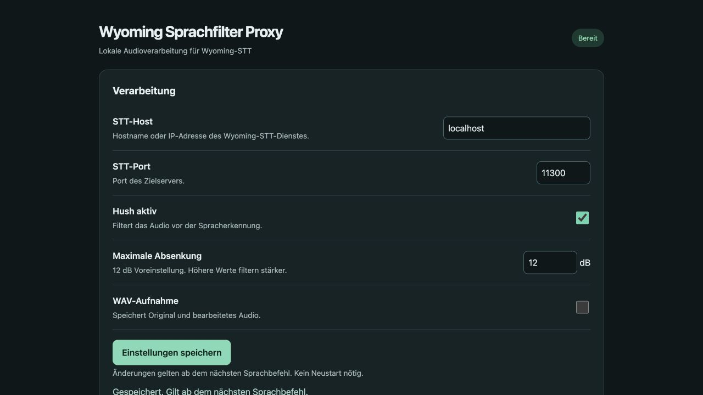
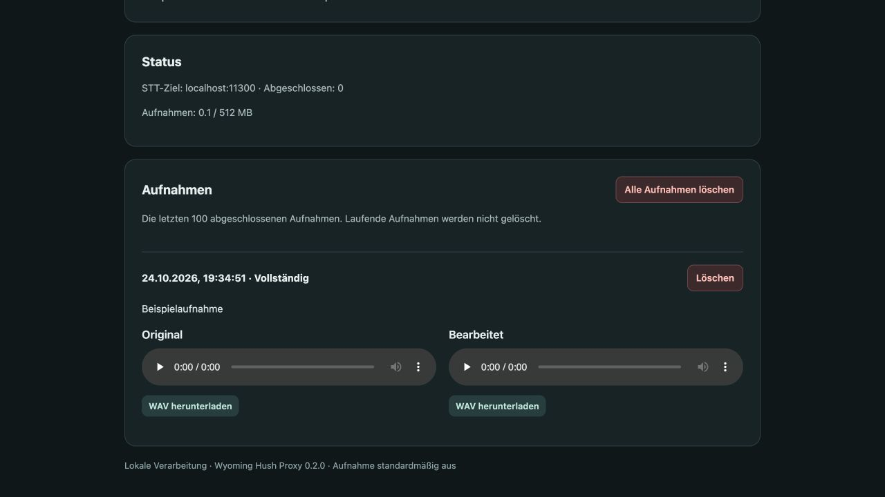

# Wyoming Hush Proxy


Local, CPU-based streaming speech enhancement for **Wyoming-compatible speech-to-text services**. The web interface is called **Wyoming Sprachfilter Proxy**.

`Voice client → Wyoming Hush Proxy → your Wyoming STT service`

The proxy uses the stateful ONNX/NumPy inference core from [livekit-plugins-hush](https://github.com/arpesenti/livekit-plugins-hush). It needs no LiveKit server, cloud service, GPU or Home Assistant token.

## Features

- Continuous 10 ms frame processing with per-utterance model/DSP state and delay/tail compensation.
- Adjustable attenuation limit: **12 dB default**, 0–60 dB. Filter bypass forwards input PCM unchanged.
- Configurable **STT hostname/IP and port**, changed through the web UI without restarting. Running utterances retain their original target and settings.
- Models and languages are discovered from the downstream STT service; model selection, language and context are forwarded.
- Optional paired WAV recording, **off by default**, labelled **Original** and **Bearbeitet** in the UI. Playback and downloads are local.
- Delete individual recordings or all inactive recordings after confirmation. Active recordings, settings, unrelated folders and symlinks are protected. Storage quota is updated immediately.
- Models are included in the image and verified against pinned checksums. Nothing is downloaded at runtime.

**Compatibility:** Wyoming ASR over TCP, 16 kHz mono PCM16 input. A service must implement Wyoming `describe/info` and `transcribe/audio-start/audio-chunk/audio-stop/transcript`. HTTP/OpenAI-compatible STT APIs require a separate Wyoming adapter. The proxy does not perform speech-end detection; clients such as Home Assistant must send `audio-stop`.





## Docker quick start

Image: **`ghcr.io/dominik-1980/wyoming-hush-proxy:0.2.0`**

```bash
mkdir -p data
sudo chown 99:100 data
docker compose up -d
```

Use the supplied [compose.yaml](compose.yaml). The container runs as UID 99/GID 100; the mounted data directory must be writable by that user. Only adjust ownership of the dedicated new data directory.

Open **`http://SERVER:10323`**, enter your STT host and port, and save. Connect your Wyoming client to **`SERVER:10322`**. The default internal ports can be published on different host ports.

Alternatively supply an initial target with `UPSTREAM_URI=tcp://stt-server:10300`. A service name works when both containers share a Docker network. For an external service use its reachable hostname/IP and published port. Saved UI target settings take precedence over this initial default.

The UI is for a **trusted local network** and has no user login. It exposes recording playback/download/delete and target configuration. Do not publish these ports to the Internet without an authenticated gateway.

## Home Assistant

1. Configure the downstream STT target in the proxy web UI first.
2. Add **Settings → Devices & services → Add integration → Wyoming Protocol**.
3. Enter the proxy server's address and port **10322**.
4. Select **Wyoming Sprachfilter Proxy** (or its discovered service name) as the speech-to-text provider in your voice assistant pipeline. Keep the original direct STT entry for comparison/rollback.

No `configuration.yaml` entry or Home Assistant restart is required. After switching to a backend with different models/languages, reload the Wyoming integration to refresh Home Assistant's cached capabilities.

## Unraid

Copy [unraid/wyoming-hush-proxy.xml](unraid/wyoming-hush-proxy.xml) to `/boot/config/plugins/dockerMan/templates-user/` and select the template under **Docker → Add Container**. It uses the published image, ports 10322/10323 and a dedicated appdata mapping. Initial target URI is optional; host and port can be configured in the UI.

## Settings and data

| Setting | Default | Purpose |
|---|---|---|
| Filter | on | Hush processing; off is a PCM bypass |
| Maximum attenuation | 12 dB | Mixes part of the input spectrum back into the model output; not a global volume adjustment |
| Recording | off | Saves a paired original/processed clip and transcript metadata |
| STT host / port | unset / 10300 | Downstream Wyoming service |
| `MAX_RECORDING_MB` | 512 | Recording quota, no automatic deletion |
| `MAX_AUDIO_SECONDS` | 60 | Maximum audio per utterance |
| `MAX_SESSIONS` | 2 | Concurrent utterance limit |

Settings persist in `/data/settings.json`; recordings in `/data/recordings/<UTC-ID>/`. Existing `original.wav` / `filtered.wav` filenames are retained for compatibility. UI labels are generic.

Delete actions permanently remove both WAVs and their metadata after the UI confirmation. Bulk deletion skips active recordings and protected/unrecognised content. It never deletes configuration or model files. To reclaim recordings manually outside the app, restart the proxy to rescan the recording quota.

`GET /healthz` reports that the proxy/model runtime is ready; it does not verify STT connectivity. Downstream connection errors appear in the UI and as Wyoming error events. A full recording quota or recording disk error does not intentionally interrupt STT.

## Build and test

```bash
docker build -t wyoming-hush-proxy:local .
docker run --rm --network none -v "$PWD/tests:/tests:ro" wyoming-hush-proxy:local \
  python -m unittest discover -s /tests -v
```

For local development, use Python 3.12 and install [requirements.txt](requirements.txt), then run `python -m unittest discover -s tests -v`. Tests use synthetic signals, temporary directories and local fake Wyoming backends, with real ONNX inference. No private audio is included.

## Scope and limitations

Hush does not identify an enrolled speaker. Enhancement may suppress desired speech as well as interference, and a cleaner or quieter recording does not establish improved transcription. Compare original/processed audio and actual transcripts in your environment. The UI does not automatically loudness-match the two recordings. Streaming output can differ from batch PyTorch inference.

This project forwards the downstream STT capabilities; it does not claim the enhancement model is equally effective for every advertised language or acoustic environment.

## Updating from the initial prototype

Keep your `/data` mapping and existing `UPSTREAM_URI` during the first start. Existing filter/recording settings and recordings are retained. The new settings fields are populated from the initial target when no saved host exists. The public service name is generic; reload the Wyoming integration and select the new STT service if Home Assistant retains the old name. No STT model files are changed by this proxy.

## Provenance and license

Apache-2.0; see [LICENSE](LICENSE) and [NOTICE](NOTICE).

- Inference/DSP/models: [arpesenti/livekit-plugins-hush](https://github.com/arpesenti/livekit-plugins-hush), commit `ab84d83864003d835013b4e914fca8df83b2cbc6`.
- Model architecture: [pulp-vision/Hush](https://github.com/pulp-vision/Hush), based on [DeepFilterNet](https://github.com/Rikorose/DeepFilterNet).
- Original model card: [weya-ai/hush](https://huggingface.co/weya-ai/hush).

[vendor-manifest.json](vendor-manifest.json) records upstream Git blob identities; [model-checksums.json](model-checksums.json) records SHA256 hashes. The inference/DSP files are unmodified. The bridge, routing, web UI and deletion implementation are project-specific code. The LiveKit agent framework and STT models are not redistributed here.
